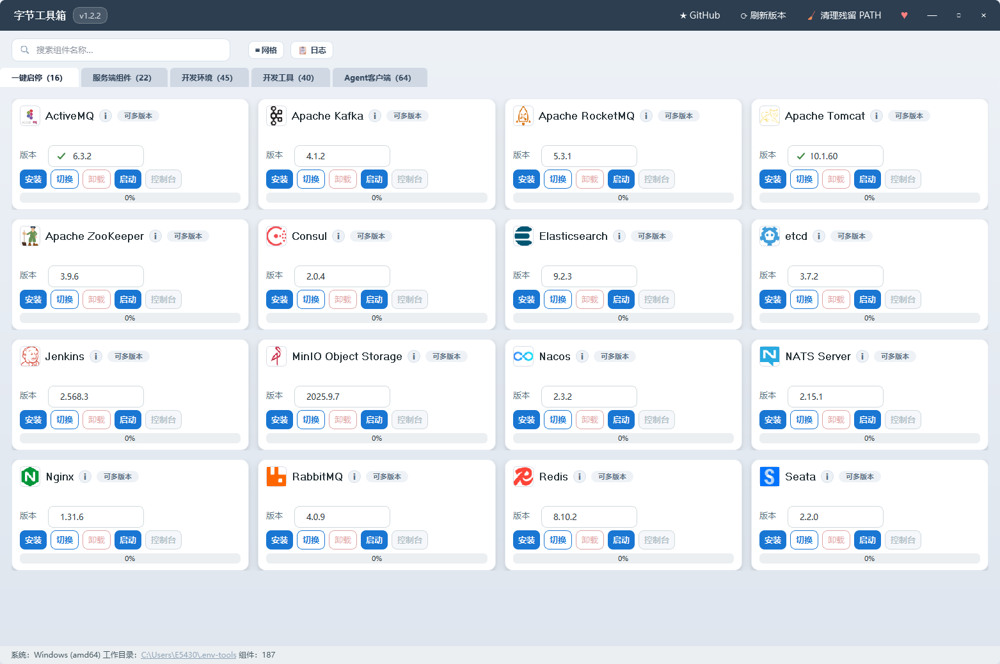

# 字节工具箱 ByteTools

<p align="center">
  
</p>

<p align="center">
  一台新 Windows / macOS / Linux 机器，<b>点几下鼠标就装好整套开发环境</b>。<br/>
  <b>61 个</b>常用组件全流程自动（下载 → 解压 → 写环境变量 → 自检），<br/>
  <b>26 个</b>常用开发工具给官方安装包直链（只下载），<b>15 个</b>服务另支持一键启停与访问页直达。
</p>

<p align="center">
  <a href="https://github.com/jilong2026/byte-tools/releases/latest"></a>
  
  
  
  
</p>

<p align="center">
  
</p>

---

## 目录

- [它解决什么问题](#它解决什么问题)
- [下载即用](#下载即用)
- [亮点](#亮点)
- [30 秒上手](#30-秒上手)
- [支持的组件](#支持的组件)
- [平台支持与例外](#平台支持与例外)
- [深入用法](#深入用法)
- [界面导览](#界面导览)
- [从源码运行](#从源码运行)
- [配置与自定义](#配置与自定义)
- [打包与发布](#打包与发布)
- [常见问题](#常见问题)
- [技术栈 · 仓库结构 · 参与](#技术栈--仓库结构--参与)
- [许可证](#许可证)

---

## 它解决什么问题

换一台电脑、或者带新人搭开发环境，重复的永远是这五步：**找官网 → 对系统架构 → 挑个"正确"的位置解压 → 配环境变量 → 开新终端验证**。一台电脑做完至少半小时，多台电脑或带新人上手就是成倍重复。

这个工具把这五步压成一次点击：选好版本，点「安装」，剩下的它做完，并且**用中文日志把每一步写出来**（用的哪个镜像、为什么换源、写了哪个变量）。

它只做**下载、解压、配环境变量**这三件事。不改你项目里的 `pom.xml` / `build.gradle`，不代你做 IDE 的 SDK 配置，也不帮你初始化数据库。

---

## 下载即用

到 [Releases 页面](https://github.com/jilong2026/byte-tools/releases/latest) 下载对应系统的最新版本并解压：

| 系统 | 文件 | 怎么用 |
|------|------|--------|
| Windows 10 / 11 (x64) | [`ByteTools.exe`](https://github.com/jilong2026/byte-tools/releases/latest/download/ByteTools.exe) | 双击运行，无需安装（内置启动画面） |
| macOS (Apple Silicon) | [`ByteTools-macos-arm64.zip`](https://github.com/jilong2026/byte-tools/releases/latest/download/ByteTools-macos-arm64.zip) | 解压后双击 `ByteTools.app` |
| Linux (x64) | [`ByteTools-linux-x64`](https://github.com/jilong2026/byte-tools/releases/latest/download/ByteTools-linux-x64) | `chmod +x` 后直接运行 |

> Intel 芯片的 Mac：自 v1.0.5 起不再提供 Intel 通用包（GitHub 已下线 Intel runner），请从[源码运行](#从源码运行)。

第一次打开时系统可能拦一下——这不是恶意软件的信号，是"没有花钱买代码签名"的信号：

- **Windows**：Defender / SmartScreen 提示"未识别应用" → 点 **"更多信息 → 仍要运行"**。
- **macOS**：提示"无法验证开发者" → 「系统设置 → 隐私与安全性」下方点 **"仍要打开"**；或执行 `xattr -cr ByteTools.app` 去掉隔离属性。
- **Linux**：双击无响应 → 终端里 `chmod +x ByteTools-linux-x64 && ./ByteTools-linux-x64`。

---

## 亮点

- **一份代码三平台**：自动判断系统与 CPU 架构（Apple Silicon 下 JDK 走 aarch64、Node 走 arm64）。
- **61 个组件一键装配**：下载 → 解压 → `XXX_HOME` + `PATH` 全流程自动，装完即用。
- **26 个开发工具只下载**：IDE / 数据库客户端 / API 工具 / 终端类给官方安装包直链，能看版本清单、点「下载」下到你选的目录（记住上次位置，下完可打开所在文件夹）。**本工具不解压、不配环境变量、不代跑安装程序**——授权与安装步骤由你自己确认。官方同时发安装器与便携包的（IDEA / PyCharm / CLion / WebStorm / GoLand / DataGrip / VS Code / DBX，以及 HeidiSQL / Bruno / Another Redis Desktop Manager / MongoDB Compass / MySQL Workbench），按钮写成「下载 ▾」，点开让你挑哪一种、并标着体积。
- **15 个服务一键启停**：Tomcat、Nginx、ActiveMQ、RocketMQ、Kafka、Elasticsearch、Seata、Nacos、RabbitMQ、Jenkins、Redis、etcd、Consul、Apache ZooKeeper、MinIO 不必再自己敲启动脚本。端口被占用时按既定策略处理并在确认框里说清楚（不平移端口——平移会让外部客户端连不上）；「停止」停不下来时只询问是否强制结束，不会背着你强杀。状态以**端口整簇是否都在听**为准（Nacos 的主口 + gRPC、Kafka 的 9092+9093、RocketMQ 的 namesrv+broker、etcd 的 2379+2380 都算），关掉工具重开也认得出正在跑什么，且识别状态的过程**绝不执行任何启动脚本**。Kafka / RocketMQ / RabbitMQ 这类"浏览器打开必然失败"的协议端口型组件，由工具自带的小服务给一张状态页——写着运行状态、端口、访问方式、登录信息与日志路径，**服务停掉后刷新会自动变成"已停止"**，不会留一张永远说"成功"的假告示。已在 Windows 真机逐个跑完「下载安装 → 启动 → 整簇端口监听 → 协议探活（如 `rabbitmqctl status`、Kafka `BrokerApiVersions`）→ 停止 → 端口释放」；**macOS 与 Linux 尚未真机验证**（见 `DEVELOPMENT.md` 规则 R5）。
- **前置运行时自动就位**：需要 JDK 的组件（Jenkins / Nacos / Kafka / RocketMQ / ActiveMQ / Tomcat / Seata）在本机没有 JDK 或版本太低时，点「启动」会先自动下载安装一个够用的 JDK 再继续；RabbitMQ 需要的 Erlang/OTP 同理（按 RabbitMQ 版本自动配 27.x / 26.x）。用户不需要自己准备任何前置依赖，也不用手改文件。
- **国内镜像优先 + 多源故障转移**：内置 11 家大陆镜像基址与 3 个 GitHub 加速器，按"大陆源在前 → 逐个换源 → 末位回退官网"走，全程中文日志，**无需手动改 URL**（少数组件只有官网一个源，见[平台支持与例外](#平台支持与例外)）。
- **多版本并存 + 生效版本切换**：61 个可装配组件都可以同时装多个版本（2026-06-06 起全量开放，不再限那几个），并在界面上显式指定哪个生效。切换中途失败自动回滚，不会留下"变量指 A、`PATH` 指 B"的半套配置；下拉框里带**绿色对勾**的版本 = 磁盘上已经装好。
- **接管你自己装的那一份 + 一键还原**：机器上原有、放在本工具目录之外的 JDK / Maven / Node 等也能被扫描出来设为生效版本（扫描只读，逐个真跑版本命令确认）。动你的系统设置之前先存原文快照，改动后可按原文逐字还原。五道硬规则（原文快照 / 最小编辑 / 关键条目校验 / 复验 / 可还原）缺一不执行。
- **卸载只删你选中的那个版本**：同组件其它版本的目录、环境变量、`PATH` 条目一概不碰；删掉的正是生效版本时会自动重排。另有标题栏「🧹 清理残留 PATH」清掉指向本工具目录但已不存在的死条目。
- **检查更新，但不替换自己**：标题栏那颗版本号兼任状态灯（六种状态见[界面导览](#界面导览)）。发现新版点一下就直接下到你选的目录，**不会改名或覆盖正在运行的程序**，也不上传任何用户信息。
- **下载可靠性**：所有请求固定携带专用 User-Agent（部分高校镜像站会屏蔽默认 UA 返回 403）；下载完成后校验实际字节数，遇到"假 200 空文件"自动换下一个源，不会留下坏包。
- **动态版本清单 + 24 小时缓存**：启动后从各家官方 API / 索引拉最新版本，拉到的清单落盘缓存一天（省 GitHub 的匿名额度），拉不到就安静回退内置清单，离线也能用。
- **搜索与过滤**：87 个组件不必逐页翻——顶部搜索框按名称 / 标识全组件模糊过滤，命中项按分类归并到同一结果列表（带分类小标题），清空即恢复；版本下拉框可直接键入 `21` / `3.12` / `LTS` 实时过滤。
- **环境变量写入不用 `setx`**：Windows 用 `winreg` 直写注册表（`setx` 有 1024 字符截断），按单条目增删 `PATH`，写完点名通知资源管理器；macOS / Linux 写入带标记的 shell 配置块，幂等更新。
- **界面**：无边框自定义窗口、卡片按窗口宽度自动分列（可切「▦ 网格 / ☰ 列表」）、渐变进度条、状态胶囊标签、彩色分级中文日志（浮层可收起，**不会自己弹出来**——出现 warn / error 只在「📋 日志」按钮上挂一个未读条数）、窗口图标在任务栏与 Alt+Tab 可见、记住上次每个组件选中的版本。
- **平台不支持时会说清楚**：有 2 个组件在 Windows 上没有可用的免安装形态（`Docker`、`Pulsar`），卡片上会写明原因并给替代做法，**不会**先装一个跑不起来的东西再让你自己猜。

---

## 30 秒上手

1. 打开工具，五个 Tab 页（一键启停 / 服务端组件 / 开发环境 / 开发工具 / Agent客户端）列出全部组件，每张卡片右上角是**当前状态**：

   | 状态 | 含义 |
   |---|---|
   | 🟢 `✓ 已配置（PATH）· openjdk version "17.0.10"` | 系统已能找到，无需再装（末尾的版本号是后台异步探测补上的） |
   | 🟠 `● 已下载，未配置` | 本地已有安装包，但环境变量还没设 |
   | 🟢 `● 已装 2 个版本 · 生效 21（21、17）` | 61 个可装配组件都用这套标签：括号内是磁盘上已装的版本（新→旧），`生效 21` 是当前生效版本 |
   | 🟠 `● 已装 2 个版本 · 均未生效（21、17）` | 装了版本，但系统的 `XXX_HOME` / `PATH` 没指向其中任何一个 |
   | 🔴 `○ 未安装` | 一个版本都没装 |

   探测到生效版本的精确版本号后，多版本那条会补在末尾：`● 已装 2 个版本 · 生效 21（21、17） · 21.0.4`。

2. 在下拉框里选版本（可直接键入过滤；带绿勾的表示磁盘上已经装着）。
3. 点「安装」，工具依次做：流式下载到 `~/.env-tools/<组件>/downloads/`（镜像优先、失败自动换源、可随时取消）→ 解压到 `~/.env-tools/<组件>/<组件>-<版本>/`（Miniconda 走静默安装器）→ 写 `XXX_HOME` 并把 `bin` 加进 `PATH` → 刷新该卡片状态。同一组件的旧版本目录**不会被删**，装第二个版本就是多版本并存。
4. 想看每一步细节，点搜索条上的「📋 日志」。

按钮的两条可用性规则：**下拉框选中的版本磁盘上已经装着时，「安装」是灰的**（悬停提示"要重新安装请先点「卸载」"，避免覆盖已装好的目录；想重装就先卸载再装。「开发工具」那 26 个是「下载」按钮，不适用这条）；**选中的版本已经是生效版本时，「切换」是灰的**（悬停提示"要换版本先在下拉框里选中"）。

装完之后**新开一个终端**验证：

```bash
java -version
mvn -v
python --version
node -v
```

---

## 支持的组件

共 **92 个**：**61 个可一键装配** + **31 个只提供官方安装包下载**（31 = 26 个 GUI 工具 + 5 个 Agent 客户端；61 个里有 15 个还额外支持一键启停）。界面按五个 Tab 分组，Tab 标题自带数量：

| Tab | 数量 | 成员 |
|-----|------|------|
| 一键启停 | 15 | Tomcat、Nginx、RabbitMQ、Kafka、RocketMQ、ActiveMQ、Nacos、Seata、Elasticsearch、Jenkins、Redis、etcd、Consul、Apache ZooKeeper、MinIO |
| 服务端组件 | 14 | MySQL、MongoDB、PostgreSQL、Pulsar、Docker、kubectl、Trivy、k9s、Docker Compose v2、Helm、NATS Server、Caddy、Traefik、Apache JMeter |
| 开发环境 | 32 | JDK、Python、Node.js、Go、Bun、Miniconda、Git、Maven、Gradle、PowerShell 7、Kotlin、GraalVM、Rust、Dart、protoc、uv、.NET SDK、SQLite、jq、pnpm、Deno、Ninja、DuckDB CLI、CMake、ripgrep、fd、bat、eza、zoxide、fzf、yq、Apache Ant |
| 开发工具 | 26 | IntelliJ IDEA、PyCharm、CLion、WebStorm、GoLand、DataGrip、VS Code、DBX、WindTerm、微信开发者工具、Eclipse IDE、Apipost、Apifox、HBuilderX、Android Studio、Visual Studio、Navicat、DBeaver、HeidiSQL、Bruno、RedisInsight、Another Redis Desktop Manager、MongoDB Compass、pgAdmin 4、MySQL Workbench、Postman |
| Agent客户端 | 5 | Cursor、ZCode、Claude Code、Codex CLI、QoderWork CN |

> **四个 Tab 各自按什么分？**「一键启停」按**能力**分（这个工具能不能替你一键起停）；
> 「服务端组件」与「开发环境」按**装在哪**分 —— 前者装在服务器/集群上、命令行操作，
> 后者跑在你这台开发机上；「开发工具」按**形态**分 —— 26 个全是带图形界面的软件。
> 排这个顺序是为了让最常问的那个问题「我是装服务器还是装本机」能一眼对上。

> 想调整归类：普通组件改 `main.py` 里 `COMPONENT_CATEGORY_OF` 的一行即可；「一键启停」那一页不用登记——组件进了启动白名单 `LAUNCH_OF` 就自动出现在那里，退出来就自动回到原分类。

下面按技术类别给明细（环境变量、检测命令、默认可用版本）。**默认可用版本只是离线兜底**：启动后工具会从各家官方源拉最新版本覆盖它，点「⟳ 刷新版本」可强制重拉。

### 语言运行时

| 组件 | 环境变量 | 检测命令 | 默认可用版本 |
|------|----------|----------|--------------|
| JDK (Temurin) | `JAVA_HOME` | `java -version` | 21 / 17 (LTS) / 11 / 8。清华 / 南大镜像上的确切文件名带 build 号，**先点「⟳ 刷新版本」再下载** |
| Python | —（走 PATH） | `python --version` | 3.12 / 3.11 / 3.10 / 3.9。Linux / macOS 见[平台支持与例外](#平台支持与例外) |
| Node.js | `NODE_HOME` | `node --version` | 20 LTS / 18 LTS / 16 |
| Go (golang) | `GOPATH` / `GOROOT` | `go version` | 1.24.x / 1.22.x |
| Bun | —（走 PATH） | `bun --version` | 1.x |
| PowerShell 7 | —（走 PATH） | `pwsh --version` | 7.6.x / 7.5.x / 7.4.x。三平台都有官方便携包（Windows zip、Linux / macOS tar.gz）；上游只在 GitHub Releases 发版，实测无国内真镜像，走 GitHub 加速器 |
| Kotlin 编译器 | —（走 PATH） | `kotlinc -version` | 2.4.x。三平台同一个 `kotlin-compiler-<v>.zip`（编译器是 JVM 产物），解压顶层是 `kotlinc/`；只在 GitHub Releases 发版，走 GitHub 加速器 |
| GraalVM (CE) | `GRAALVM_HOME` | `java -version` | 25.x。**刻意不复用 `JAVA_HOME`** —— 写同一个变量会和 JDK (Temurin) 互相覆盖对方的生效版本。资产按平台分档，版本号在**资产名**里（tag 是 `graal-…`，与版本不是一回事） |
| Rust | —（走 PATH） | `rustc --version` | 1.99.x / 1.98.x / 1.97.x。**仅 Windows**：官方 `.exe` 安装器已停发、合并 tar.xz 里没有统一 `bin/`，改用官方 MSI 做**管理性提取**（`msiexec /a`，免提权、不写注册表）。⚠ 还需要一个链接器：没装 VS Build Tools 时 `rustc` 能编译但链接不过（Git for Windows 自带的 `link.exe` 会冒充 MSVC 链接器，报的是莫名其妙的 `link: extra operand`）。只登记了 Windows，见[平台支持与例外](#平台支持与例外) |
| .NET SDK | —（走 PATH） | `dotnet --version` | 10.0.x。走官方 **zip 便携包**（不是安装器），解压根就是 `dotnet.exe`；版本清单读微软 `release-metadata` JSON，登记的是 **SDK 版本号**（10.0.401）而不是它所属的 release 号。只有微软 CDN 一个源（清华 / 阿里都没有它的制品树） |
| Deno | —（走 PATH） | `deno --version` | 2.x。单文件运行时，zip 顶层直接就是 `deno.exe`；只在 GitHub Releases 发版，走 GitHub 加速器 |

### 构建工具

| 组件 | 环境变量 | 检测命令 | 默认可用版本 |
|------|----------|----------|--------------|
| Apache Maven | `MAVEN_HOME` | `mvn -v` | 3.9.x / 3.8.x |
| Gradle | `GRADLE_HOME` | `gradle -v` | 8.x / 7.x |
| protoc（Protobuf 编译器） | —（走 PATH） | `protoc --version` | 36.x。zip 顶层是 `bin/` + `include/` 两个并列目录；只有 Windows 一档按 R1 实测过（npmmirror 有真镜像），Linux / macOS 官方也有包但未实测，见[平台支持与例外](#平台支持与例外) |
| CMake | —（走 PATH） | `cmake --version` | 4.4.x。包外面套了一层 `cmake-<v>-windows-x86_64/`，而 `cmake.exe` 在那层的 **`bin/`** 里（不是根目录 —— 这一格是被归档布局审计抓出来的，抄相邻组件会抄错） |
| Ninja | —（走 PATH） | `ninja --version` | 1.13.x。单文件 zip，解压根即 `ninja.exe` |

### 应用服务器与 Web 服务

| 组件 | 环境变量 | 检测命令 | 默认可用版本 |
|------|----------|----------|--------------|
| Apache Tomcat | `CATALINA_HOME` | `catalina version` | 10.1 / 9.0 / 8.5 |
| Nginx | —（走 PATH） | `nginx -v` | 1.31.x / 1.30.x / 1.28.x。仅 Windows 有官方预编译 zip，见[平台支持与例外](#平台支持与例外) |
| Caddy | —（走 PATH） | `caddy version`（本工具用 `--version`） | 2.11.x。单文件 Web 服务器，自动 HTTPS；`caddy` 只有 GitHub 一档，走加速器。**只提供下载与环境变量**，起服务请自己 `caddy run`（本工具没登记它的启停） |
| Traefik | —（走 PATH） | `traefik version` | 3.7.x。云原生反向代理，同上只下载不启停。⚠ 它认的是子命令 `version`，`--version` 会打印帮助并回非 0 —— 版本探测命令按实测写 |

### 数据库

| 组件 | 环境变量 | 检测命令 | 默认可用版本 |
|------|----------|----------|--------------|
| MySQL Server | `MYSQL_HOME` | `mysql --version` | 8.0.x（阿里 / 华为云镜像 + 官网）。**解压后还需自己执行 `mysqld --initialize`**，本工具不做数据库初始化 |
| MongoDB | —（走 PATH） | `mongod --version` | 8.0.x / 8.0.0（Windows / Linux；macOS 无免安装二进制） |
| PostgreSQL | `PG_HOME` | `psql --version` | 17.x / 16.x（仅 Windows 支持自动下载） |
| SQLite（命令行） | —（走 PATH） | `sqlite3 --version` | 3.5x。官方 `sqlite-tools-win-x64-<六位版本>.zip`（3.54.0 → `3540000`，路径还带年份目录），解压根就是 `sqlite3.exe`。**只有 sqlite.org 一个源**（清华 404、华为那个 `sqlite/` 目录回 200 但只有 12 KB 门户壳，是假源） |
| DuckDB CLI | —（走 PATH） | `duckdb --version` | 1.5.x。单文件分析型数据库，解压根即 `duckdb.exe`；只在 GitHub Releases 发版 |

### 键值缓存

| 组件 | 环境变量 | 检测命令 | 默认可用版本 |
|------|----------|----------|--------------|
| Redis | —（走 PATH） | `redis-server --version` | 8.10.x。**仅 Windows，且是社区构建**（`redis-windows`），不是官方出品 —— 官方只发源码，`download.redis.io` 上的 tar.gz 装不出 Windows 可执行文件，卡片上会写明这一点。支持一键启停：数据落在 `~/.env-tools/redis-data`，命令行启动用的是 Redis 默认（只监听 127.0.0.1、无密码），本工具不改 `bind`、也不设 `requirepass` |

### 容器与编排

| 组件 | 环境变量 | 检测命令 | 默认可用版本 |
|------|----------|----------|--------------|
| Docker Desktop | —（走 PATH） | `docker --version` | 27.x / 26.x（Windows 不支持自动下载，须用官方安装器） |
| kubectl | —（走 PATH） | `kubectl version --client` | 1.31.x / 1.30.x（三平台均支持；优先 DaoCloud 代理源；Linux / macOS 下的是无扩展名单文件，需 `chmod +x`） |
| Helm | —（走 PATH） | `helm version` | 4.3.x。Kubernetes 包管理器。⚠ 它的 GitHub release 里只有 `.asc` / `.sha256sum` 签名，真正的二进制在 `get.helm.sh`（版本入口也在那：`helm-latest-version` 纯文本） |
| k9s | —（走 PATH） | `k9s version` | 0.51.x。Kubernetes 终端界面，单二进制；走 GitHub 加速器 |
| Docker Compose v2 | —（走 PATH） | `docker-compose version` | 5.x。独立二进制版 Compose。**能装能进 PATH，但真跑起来仍需要一个能用的 Docker 引擎**（Docker Desktop 在 Windows 没有免安装形态，见 Docker 卡片的引导）；登记它是因为 `docker-compose version` 这类自检不需要引擎。首位走 DaoCloud 的 GitHub 代理树（实测与官方同字节数） |
| Trivy | —（走 PATH） | `trivy --version` | 0.75.x。容器 / 文件系统漏洞扫描，单二进制；走 GitHub 加速器 |

### CI / CD

| 组件 | 环境变量 | 检测命令 | 默认可用版本 |
|------|----------|----------|--------------|
| Jenkins | `JENKINS_HOME` | `jenkins --version` | 2.x / LTS |

### 消息队列

| 组件 | 环境变量 | 检测命令 | 默认可用版本 |
|------|----------|----------|--------------|
| RabbitMQ | `RABBITMQ_HOME` | `rabbitmqctl version` | 4.0.x / 3.13.x（运行时依赖 Erlang/OTP，工具会按版本自动配 27.x / 26.x） |
| Apache Kafka | `KAFKA_HOME` | `kafka-server-start.sh --version` | 4.1.x / 3.9.x |
| Apache RocketMQ | `ROCKETMQ_HOME` | `mqadmin version` | 5.x |
| Apache Pulsar | `PULSAR_HOME` | `pulsar version` | 3.x（主命令只有 POSIX shell 脚本，Windows 不支持） |
| ActiveMQ | `ACTIVEMQ_HOME` | `activemq --version` | 6.3.x / 5.18.x |
| NATS Server | —（走 PATH） | `nats-server --version` | 2.15.x。轻量消息 / 主题服务器，单二进制；只在 GitHub Releases 发版。**只提供下载**，启停未登记 |

### 服务发现 / 分布式事务

| 组件 | 环境变量 | 检测命令 | 默认可用版本 |
|------|----------|----------|--------------|
| Nacos | `NACOS_HOME` | `startup.sh` / `startup.cmd` | 2.x（发布在 GitHub Releases，无真镜像，走 GitHub 加速器） |
| Seata | `SEATA_HOME` | `seata-server.sh -h` | 2.x（走 Apache 分发目录，八家大陆镜像） |
| Apache ZooKeeper | —（走 PATH） | 安装检测看 `bin/zkServer` | 3.9.x（七家 Apache 镜像 + 官方 CDN）。**支持一键启停**：官方包只有 `zoo_sample.cfg`，所以工具在 `~/.env-tools/zookeeper-data/conf` 里生成一份 `zoo.cfg` 副本再改 `clientPort` / `dataDir`（官方目录一个字都不改）；启动**绕开厂商的 `zkServer.cmd` 包装器直接拉 java**（那个 .cmd 会把安装目录里的 zoo.cfg 塞成第一个参数，而且停止时只杀包装器、留下监听端口的孤儿 java）。需要 JDK，缺了会自动先装 |
| Consul | —（走 PATH） | `consul version` | 2.0.x。**支持一键启停**：`consul agent -dev` 形态，HTTP 口用 `-http-port` 命令行直给（不落配置文件），控制台在 `/ui`、健康检查在 `/v1/health`。只有 `releases.hashicorp.com` 一个源（不是 GitHub，没有加速器可用），国内直连实测偏慢 |
| etcd | —（走 PATH） | `etcd --version` | 3.7.x。**支持一键启停**：单 exe + 命令行改口，客户端 2379 / peer 2380 两口一起判（整簇监听才算起来）；数据目录外移到 `~/.env-tools/etcd-data`，不落任何配置文件 |

### 搜索引擎

| 组件 | 环境变量 | 检测命令 | 默认可用版本 |
|------|----------|----------|--------------|
| Elasticsearch | `ES_HOME` | `elasticsearch --version` | 9.x / 8.x（华为云镜像 + 官网；镜像只同步新版本，老版本由故障转移兜底） |

### 版本控制

| 组件 | 环境变量 | 检测命令 | 默认可用版本 |
|------|----------|----------|--------------|
| Git | — | `git --version` | Windows 走 MinGit（华为云 / npmmirror 优先）；macOS、Linux 不提供自动下载（上游只有源码包，界面提示用 apt / dnf / yum / brew） |

### Python 发行版

| 组件 | 环境变量 | 检测命令 | 默认可用版本 |
|------|----------|----------|--------------|
| Miniconda | `CONDA_HOME` | `conda --version` | py312 / py311 / py310（走静默安装器） |
| uv（Python 包/环境管理） | —（走 PATH） | `uv --version` | 0.13.x。zip 顶层直接就是 `uv.exe` / `uvw.exe` / `uvx.exe`，没有子目录；**只保证 `uv` 这条命令可用**，shell 集成与它自己托管的 Python 版本不在本工具目录里。同样只实测了 Windows |


### 命令行小工具（单二进制，解压即用）

这一批都没有 `XXX_HOME` 概念 —— 工具只把它们解压到 `~/.env-tools/<组件>/<组件>-<版本>/` 并把那个目录加进 `PATH`，卸载也只删这一格。版本清单全部从 GitHub Releases 的**资产名严格匹配**读回来（同一个 release 里往往同时躺着 `.sha256` / `.sbom` / arm 包，靠后缀猜会装错东西）。

| 组件 | 检测命令 | 默认可用版本 | 备注 |
|------|----------|--------------|------|
| jq | `jq --version` | 1.8.x | 裸 exe 单文件（不是 zip），JSON 处理 |
| yq | `yq --version` | 4.5x | 同上裸 exe，YAML 版 jq |
| ripgrep (`rg`) | `rg --version` | 15.x | 递归文本搜索；它的 release tag **不带 `v` 前缀**（这一条单独钉过，拼错就 404） |
| fd | `fd --version` | 10.x | 文件名搜索 |
| fzf | `fzf --version` | 0.74.x | 模糊查找器。**只做命令可用**，shell 键位绑定请自行配置 |
| bat | `bat --version` | 0.26.x | 带语法高亮的 `cat` |
| eza | `eza --version` | 0.23.x | `ls` 的替代品 |
| zoxide | `zoxide --version` | 0.10.x | `cd` 的模糊跳转。同样不做 shell 集成（它的 `init` 需要写进你的 rc 文件） |
| pnpm | `pnpm --version` | 12.x | Node 包管理器。**只放二进制**，不改 `corepack`、不动全局 `node_modules`；要用它接管 `npm` 得你自己 `corepack enable` |
| uv | `uv --version` | 0.13.x | Python 包 / 环境管理器，见上面 [Python 发行版](#python-发行版) |
| protoc | `protoc --version` | 36.x | 见上面 [构建工具](#构建工具) |

### 关于那 26 个「开发工具」

它们是 GUI 软件，本工具只负责"把官方安装包下到你选的目录"，所以卡片上**只有版本下拉框和下载按钮**——没有绿勾、不扫你的磁盘、没有切换与卸载按钮，也不会解压或写环境变量。

- 能列出版本清单的都有官方机读源（JetBrains 数据接口、VS Code 的 `update.code.visualstudio.com`、GitHub Releases、各家官方 JSON）。官方**没有**机读版本接口的（微信开发者工具 / Eclipse / Visual Studio / Navicat）**不硬编一个"最新版"出来**——清单只能内置、刷新时按缺源跳过，但照样能走官方直链下载。
- **商业订阅软件**（JetBrains 全家桶、Navicat 等）只提供官方安装包直链，**不含授权**，装不装、装到哪由你自己决定（悬停在「下载」按钮上也能看到这句说明）。

---

## 平台支持与例外

自动下载的前提是官方提供"下载即解压可用"的包。以下组合没有这种包，工具会在卡片上**写明原因并给替代做法**，而不是装一个跑不起来的东西：

| 组件 | 平台 | 情况与替代做法 |
|------|------|----------------|
| Docker | Windows | 官方只发安装器（涉及 WSL2 / Hyper-V 集成与服务注册），请到 docker.com 手动下载 |
| Apache Pulsar | Windows | 主命令 `pulsar` 是 POSIX shell 脚本，官方起步要求 Docker 或 WSL |
| RabbitMQ | Windows | 属"安装器 + 服务注册"场景。工具能自动下载它、并按版本自动配好配套的 Erlang/OTP 前置再一键启停（4.x 配 27.x、3.13 配 26.x）；Windows 安装器形态仍可用于其它场景 |
| Nginx | Linux / macOS | 上游只发源码包，请用 `apt / dnf / yum install nginx` 或 `brew install nginx`。Windows zip 实测只有华为云两个子域同步（清华 / 北外 / 南大 / 阿里 / 腾讯均 404） |
| Python | Linux / macOS | 官方只提供源码包，不是解压即用的解释器（未决事项，见 `DEVELOPMENT.md`） |
| PostgreSQL | Linux / macOS | EnterpriseDB 只提供 Windows 二进制 zip；Linux 用发行版包管理器，macOS 用 `brew install postgresql` |
| MongoDB | macOS | 官方只有源码或 Homebrew formula，请用 `brew install mongodb-community` |
| Git | macOS / Linux | 上游只有源码包，请用发行版包管理器或 brew |
| kubectl | Linux / macOS | 能下；下的是无扩展名单文件，需 `chmod +x` 后运行 |
| JDK | 全平台 | 镜像上的确切文件名带 build 号，**必须先点「⟳ 刷新版本」**才解析得出来 |
| MongoDB / PostgreSQL | 全平台 | 实测没有任何大陆镜像，只有官网单源，国内速度偏慢属正常 |
| Rust | Linux / macOS | 上游只发 `rustup-init` 与源码包，没有"解压即用"的目录形态（合并 tar.xz 里是 `rustc/` + `cargo/` 等组件目录，要靠 installer 合并 sysroot）。请用官方 `rustup` 或系统包管理器安装 |
| Redis | Linux / macOS | 官方只发源码包；本工具登记的 Windows 包是**社区构建**（非官方），不挪到 POSIX 平台。Linux 用 `apt / dnf install redis`，macOS 用 `brew install redis` |
| protoc | Linux / macOS | 官方也有 `protoc-<v>-{linux-x86_64,osx-*}.zip`，但本工具尚未按 R1 实测那两个平台的源。用 `apt install protobuf-compiler` 或 `brew install protobuf`（版本可能落后官方） |
| uv | Linux / macOS | 官方也发 tar.gz，同样未实测。用官方安装脚本 `curl -LsSf https://astral.sh/uv/install.sh | sh`，或 `brew install uv` |

---

## 深入用法

### 同一组件装多个版本，切换「生效版本」

61 个可装配组件全都支持多版本并存（只下载的 26 个磁盘上不落东西，不在这一类），每个版本一个目录：`~/.env-tools/<组件>/<组件>-<版本>/`（例如 `jdk-21` 与 `jdk-17` 并存）。界面上的「生效版本」指明"系统现在实际在用哪一个"。

- **绿色对勾 = 磁盘上已装**。带勾的版本可以直接点「卸载」；没勾的点了也没东西可删，所以「卸载」是灰的。
- **已装版本一定会出现在下拉框里**。在线清单会更新，某个版本可能已被挪出清单但你磁盘上还装着——这时下拉框会按版本号大小把它补回原位并带上绿勾；否则这种版本既选不中、也切不了、还卸不掉，只能手工删目录。补录对所有可装配组件一视同仁（2026-10-06 起）——原先只给多版本组件补，jenkins / nacos 这类照样会遇到「清单里没有、磁盘上装着」。
- **点「切换」= 把选中的版本设为生效版本**：`XXX_HOME` 改指该版本目录，本组件在 `PATH` 里的条目收敛成生效版本那一条；其它组件的条目、你自己放在本工具目录之外的条目都不动。中途任何一步失败都按切换前的状态自动回滚，日志写清回滚结果，不会出现"`XXX_HOME` 指 21、`PATH` 指 17"这种半套配置。
- **卸载只动选中的那个版本**：只删该版本的目录与它自己的 `PATH` 条目，同组件其它版本的目录、变量、条目一概不碰。摘要里逐条写明做了什么，例如 `已删除安装目录：…jdk-21`、`已删除环境变量：JAVA_HOME`、`已从 PATH 移除：…jdk-21\bin`、`PATH 中没有本次卸载范围的条目`。
- **删掉的正是生效版本时会自动重排**：日志出现 `生效版本已自动切到 17.0.12`（取剩余里版本号最高的）；生效版本还在、只是环境变量被这次卸载带偏时，是 `已按生效版本 21.0.4 重建环境变量与 PATH`；删掉该组件最后一个已装版本时是 `已无安装版本，生效登记已清除`。
- **你自己装的、放在本工具目录之外的那一份不会被动到**：`XXX_HOME` 指向本工具组件目录之外时，既不删它、也不改成别的版本，日志会写明这份变量"未删除"。删掉生效版本后的重排同样只在工具自己的组件目录范围内进行，绝不接管你放在目录外自己装的那一份。
- **老配置照样能用**：这个功能上线前就装好的组件，卡片按系统里现有的 `XXX_HOME` 判断哪个版本生效；点一次「切换」后以界面登记的为准。
- 装新版本时环境变量会指向刚装的这个版本；想让卡片上的「生效」明确落在它身上、并把本组件在 `PATH` 里的多条条目收敛成一条，再点一次「切换」即可。
- 「切换」在其它组件上的含义更简单：只在本地已解压的目录里挑版本号最高的那个来配置环境变量，不重新下载（适合你已经手动把压缩包放好的场景）。
- 本工具**不**改写你项目里的 `pom.xml` / `build.gradle`，也不做 IDE 内的 SDK 配置。IDE 里要指定某个 JDK，请到 IDE 自己的 SDK 设置里填对应版本的目录。

### 接管你自己装的版本（以及一键还原）

上面那套管的是本工具下到 `~/.env-tools/` 里的版本。你机器上原来装的（`E:\soft\jdk\jdk17` 这种）同样能被认出来并设为生效版本：

1. **扫描**：展开卡片底部的「系统里检测到的版本」。它会查环境变量、`PATH` 条目，以及 Python 的 `py -0p` / 注册表登记。**扫描只读**，不动任何设置——扫描前会提示，展开才开扫。每一行都要**真跑一次版本命令**确认才列出来，探测不出来的目录宁可少显示，也不显示一个认错了的。
2. **切过去**：先只改用户级环境变量（不弹权限窗口）。改完会**复验**"新终端里第一条命中的到底是谁"：
   - 已经指向目标版本 → 完成；
   - 被更靠前的目录压住（Windows 的进程 `PATH` 是"系统段整体在前 + 用户段整体在后"，只写用户级**压不住**系统级同名条目）→ 先弹一个确认框，逐条列出"要改什么、改成什么、原来是什么"，你同意后才请求管理员权限，在**系统 `PATH` 最前面插入**目标目录；
   - 拿不到复验结果 → **不升级**，如实报"未能复验，请重开终端确认"。
3. **还原**：接管生效后卡片上常驻「↩ 还原到我之前的设置」，按**接管前的原文**逐字写回（包括 `%JAVA_HOME%` 这类占位符与原来的变量类型）。重启程序后按钮仍在。
4. **安全边界**：动系统变量一律"先存原文快照（另存一份备份文件）+ 只在原文上整条插入、不重排不去重不改大小写 + 写完重读逐条校验（含 `system32` / `Windows` 的关键条目少一条就立刻回滚）+ 复验 + 可还原"。任何一项不通过就自动还原并如实报错，**不会出现"报成功但实际没生效"**。你在 UAC 窗口上点"否"、或助手超时，都按"未做任何改动"处理。

外部版本**只出现在这个折叠区里**：不进版本下拉框（下拉框是版本反查的关键），也永远不参与卸载——本工具不删你自己装的东西。这个能力只对 JDK / Python / Node.js / Go / Maven / Gradle / Bun 这 7 个组件开放。

### 「切换」看着没生效：工具会自己解决

还有一种情况不是"接管你自己装的那一份"，而是**本工具装的版本被你系统里的老版本压住**。本机实测的例子：系统变量 `PATH` 里有你自己装的 `E:\soft\maven\apache-maven-3.9.2\bin`，而本工具装的 3.10.0 写在用户变量里——因为"系统段整体在前"，用户级怎么写都压不住那条。

工具按**抢命令的那条写在哪一段**分别处理，能自己解决就自己解决：

- **写在用户变量里**（只是排在我们前面）：把本工具那条让到用户变量最前，再复验一次——**不弹权限窗口**。
- **写在系统变量里**：弹确认框逐条列出要改什么，同意后才请求管理员权限，**只在系统 `PATH` 最前插入**本工具这个版本的目录，**原有条目一条不删**（你自己装的那份仍留在系统变量里，只是排到后面）；改完复验，通过才算成功。写完同样会**点名通知资源管理器**——提权改动是助手子进程写的注册表，主程序不补这一声，你会看到"注册表已经对了、你自己新开的终端还是旧版本"。
- **两边都找不到**：**不弹权限窗口**，如实说明为什么本工具不接手（病灶不在 `PATH` 这两段里，改系统变量也未必对症）。

两种情况都先把改动前的原文存下来，卡片上常驻「↩ 还原到我之前的设置」可一键写回（还原同样是系统级改动，写完也会通知一次资源管理器，否则"还原之后新开的终端"还会命中被还原掉的那个版本）。另外，**切换下一个版本、或卸载这个版本之前，本工具都会先把系统变量还原**，所以系统 `PATH` 里不会留下指向旧目录、或指向已被删目录的残条。你在确认框或 UAC 窗口上点"否"，一律按"未做任何改动"处理。

### 环境变量什么时候生效

- **Windows**：新开命令行 / PowerShell 窗口就能读到新值；已打开的窗口需要重启。本工具每次写完后（用户变量、以及提权写的系统变量都算）会**点名通知资源管理器**（`Shell_TrayWnd`）让它立刻重建自己那份环境，所以从开始栏 / 任务栏 / 桌面新开的终端 1 秒内就是新值。
- **还不变就一定是"宿主进程"旧**：Windows 是把环境块**复制**给新进程的。IDE 和任何常驻程序（它们内部再开终端）揣的还是自己启动那一刻的环境，从它们里面开的终端重开多少次都不会变。切换后日志会点名"比这次切换更早、还开着的终端窗口"（含 pid 与启动时间），照着关掉整个窗口即可；标了「管理员窗口」的那种，本工具的通知进不去，只能整窗关掉重开。
- **多版本切换同样受这一条约束**：切换生效版本时本工具会立刻把新值同步给自己，但**已经开着的终端和 IDE 看不到这次改动**——终端要重开窗口，IDE（IntelliJ IDEA / Eclipse / VS Code 等）要整个重启，只在 IDE 里新建一个终端标签有时仍然不够。**Windows Terminal 同理**：它的新标签页、新窗口都继承进程启动时那份环境块，要的是把整个 Windows Terminal 关掉重开，不是新开一个标签——新标签页里 PowerShell 会重新打印版权横幅，看着像新窗口，环境其实还是宿主那份旧的。日志结尾那句"已开着的终端与 IDE 需重开才会读到新值"就是这个意思。
- **拿不准就自己新开一个终端**：Windows 是把环境块**复制**给新进程的，所以**全新打开**的 PowerShell / cmd 窗口读到的就是当前生效的那份环境；已经开着的窗口（包括 IDE 内部开的终端、Windows Terminal 的新标签页）读到的仍是它们启动时那份旧的。
- **`where java` 可能仍然先命中 Oracle 的 javapath**：Oracle 的 Java 自动更新会在**系统** `PATH` 里插一条 `C:\Program Files\Common Files\Oracle\Java\javapath`，而本工具写的是**用户**变量，用户条目排在系统条目之后。这种情况下即使 `JAVA_HOME` 已经指到我们装的版本，直接敲 `java -version` 报的仍是 javapath 那份。确认办法见下面「怎么验证装的是哪一份」；确认修法是把系统 `PATH` 里那条 javapath 删掉（需要管理员权限改系统环境变量）。
- **macOS / Linux**：`source ~/.zshrc`（或 `~/.bashrc` / `~/.bash_profile` / `~/.profile`），或直接重开终端。

### 怎么验证装的是哪一份

```bash
java -version
mvn -v
python --version
node -v
mysql --version
git --version
conda --version
```

刚切过多版本组件的生效版本？在**新开**的窗口里跑下面三行，就能确认改的是不是你以为的那一份（`where` 的输出按 `PATH` 里的先后顺序排列，**第一行才是真正被执行的那个**）：

```bat
echo %JAVA_HOME%
where java
%JAVA_HOME%\bin\java -version
```

- `echo %JAVA_HOME%` 应显示 `C:\Users\<你>\.env-tools\jdk\jdk-<生效版本>`（多版本组件切换后就是它）。
- `where java` 的第一行应当落在同一个目录下。若第一行是 `C:\Program Files\Common Files\Oracle\Java\javapath\java.exe`，说明 Oracle 的 javapath 抢在前面，直接敲 `java` 用的还是它；第三条命令用 `%JAVA_HOME%\bin\java` 绕开 `PATH`，可用来确认我们这份没问题。

### 清理残留 PATH

手工删过安装目录、或卸载中途被打断，`PATH` 里可能留下指向本工具目录但目录已不存在的死条目。点标题栏 **「🧹 清理残留 PATH」** 一键清掉它们（只处理指向本工具目录的死条目，其它程序的 `PATH` 条目不动）。

---

## 界面导览

| 位置 | 内容 |
|---|---|
| 标题栏（左） | 图标 + 软件名 + **版本号 chip**。chip 兼任状态灯：普通 = 还没查；`⟳ v1.2.1 检查中` = 正在查；`v1.2.1 最新` = 已是最新；`↓ v1.2.2 待更新`（琥珀色）= 有新版，**点一下直接下载**；`↓ 37%` = 正在下载；`? v1.2.1 未查到`（灰色虚线）= 没查到，tooltip 写明失败原因。**任何时刻版本号都在**——报问题第一眼要能对上版本 |
| 标题栏（右） | 「★ GitHub」打开仓库 · 「⟳ 刷新版本」绕过缓存强制重抓在线清单 · 「🧹 清理残留 PATH」清死条目 · 「♥」支持作者 · 最小化 / 最大化 / 关闭 |
| 搜索条 | 组件搜索框（按名称 / 标识模糊过滤，右侧实时显示"匹配 N / 87 个组件"）；搜索时收起 Tab，把命中组件按分类归并到同一结果列表（带分类小标题），一眼看全、不用切页，清空即恢复；旁边是「▦ 网格 / ☰ 列表」视图切换与「📋 日志」开关 |
| 卡片区 | 四个横向 Tab（标题带数量）。每张卡片：名称、状态标签（悬停看完整说明）、版本下拉（可搜索，磁盘已装的带绿勾）、操作按钮（安装 / 切换 / 卸载，可启停的还有启动 / 停止 / 控制台或访问页，只下载的只有下载）、渐变进度条。卡片按窗口宽度自动分列 |
| 日志浮层 | 默认收起、浮在卡片区下方；点「📋 日志」展开、再点收起。**不会自动弹开**——出现 warn / error 时只在按钮上挂未读条数（`📋 日志 (N)`），想看才点。浮层里可「导出诊断」（诊断报告 + 本次会话日志，反馈问题时附上它）。四色分级（info 灰、ok 绿、warn 橙、error 红），全程中文（含镜像切换与故障转移过程） |
| 底部状态栏 | 系统信息、**可点开的工作目录**（点一下在资源管理器里打开）、组件计数。版本号不在这里，在标题栏那颗 chip |

检查更新的三条承诺（`DEVELOPMENT.md` 规则 R12）：

1. **只读、后台、静默**：启动后一天最多自动查一次，走后台线程、8 秒超时；**连不上时完全静默**，不弹一句"检查失败"（`github.com` 在国内偶发整天连不上是常态，那是网络问题不是软件问题）。手动点版本号则立刻回答。
2. **绝不替换自己**：只做"查到新版本 + 把新包下到你选的目录 + 核对字节数"，不改名、不覆盖、不重启正在运行的程序——杀软与 SmartScreen 对"程序自我替换"极易误报，失手一次你就既没更新完也打不开软件了。
3. **不遥测**：请求里不带任何查询参数，也不上报任何用户信息（这是"检查更新"和"遥测"的分界）。

下载新包的第一源是 **Gitee 直链**（境内链路实测明显更快），Gitee 上没有该附件时自动退到 GitHub 加速器与官网；GitHub 被拦或超了未认证配额时，**查询本身也会退到 Gitee**，不会因此就报"没查到"。

---

## 从源码运行

只在"下载即用"里的安装包跑不起来、或者你要改代码时才需要。

**环境要求**：Python 3.10 – 3.14（PySide6 6.11 声明 `requires_python >=3.10,<3.15`）；Windows 10 / 11、macOS 12+、Ubuntu 20.04+；网络要能访问对应组件的下载源（Apache 归档、Adoptium API、Node.js dist 等）；磁盘按所装组件计，建议预留 3 GB 以上（JDK + Maven + Node + Python + MySQL 约 1.5–2 GB）。

### Windows：两个一键脚本

| 脚本 | 作用 |
| --- | --- |
| `一键启动项目.bat` | 准备环境后直接启动 GUI（源码方式，改完代码立刻生效） |
| `一键打包exe.bat` | 准备环境后调用 PyInstaller，产出 `dist/ByteTools.exe`（单文件，内置启动画面） |

两者共用同一套自动装配流程：

1. 先看 `.venv` 是不是已经能用；能用就跳过找解释器这一步，不浪费流量。
2. 找可用的 Python（**3.10 – 3.14**，与 PySide6 的 `requires_python` 对齐）：`py -3.12/3.13/…` → `python` / `python3` → `%LOCALAPPDATA%\Programs\Python\*` 与 `%ProgramFiles%\Python*` 目录扫描。**一个都没有就自己装**：先 `winget`，再按 华为云 → npmmirror → python.org 的顺序下载官方安装包静默安装（用户级、无需管理员、不写 PATH）。
3. 复用已有 `.venv`；缺失或损坏时自动创建 / 重建（`--clear`）。
4. 依赖缺失时安装 `requirements.txt`，镜像顺序 清华 TUNA → 阿里云 → 官方 PyPI；打包脚本额外安装 PyInstaller。
5. 启动 `main.py`，或按 `byte-tools.spec` 打包并在结束时显示产物大小与时间。

```text
双击 一键启动项目.bat  →  自动配置 + 启动 GUI
双击 一键打包exe.bat   →  自动配置 + 生成 dist/ByteTools.exe
```

> 脚本只读写项目目录内的 `.venv`，不会修改系统 PATH，也不会动系统全局 Python。只有在本机一个可用 Python 都没有时，它才会在**当前用户的** `%LOCALAPPDATA%\Programs\Python` 下装一份 3.12。想脚本化调用可加参数 `nopause`（跑完不等待按键）。

### macOS / Linux：手动四步

```bash
git clone https://github.com/jilong2026/byte-tools.git
cd byte-tools

python3 -m venv .venv
source .venv/bin/activate          # Windows 上是 .venv\Scripts\activate

pip install -r requirements.txt    # PySide6 + requests

python main.py
```

首次启动会自动创建工作目录：

```
~/.env-tools/            # 所有下载的压缩包与解压后的组件都在这里
├── jdk/
│   ├── downloads/       # 原始压缩包
│   └── jdk-21/          # 解压后的 JDK
├── maven/
├── node/
├── config.json          # 偏好与登记表（选中版本、生效版本、下载目录、更新检查状态）
└── version_cache.json   # 在线版本清单的 24 小时缓存
```

---

## 配置与自定义

### 改 / 加组件版本清单

打开 `main.py`，找到 `build_components()`。每个组件的默认版本列表都在这里：

```python
components.append(
    Component(
        key="jdk",
        display_name="JDK (Temurin)",
        env_var="JAVA_HOME",
        path_subdir="bin",
        exec_name="java",
        version_args=["-version"],
        versions=[
            ComponentVersion(
                version=v,
                url_map=_adoptium_jdk_url(v),
                archive_map={"Windows": "zip", "Darwin": "tar.gz", "Linux": "tar.gz"},
            )
            for v in ("22", "21", "17", "11", "8")   # 加入 22
        ],
    )
)
```

> `versions` 只是**离线默认清单**。启动后后台会自动向官方 API 拉真实版本覆盖它（拉不到就用这份，保证离线可用）；想改拉取逻辑就动 `FETCHERS` 字典。新增一个组件的完整流程与踩坑清单见 [`docs/ONBOARDING_NEW_COMPONENT.md`](docs/ONBOARDING_NEW_COMPONENT.md)。

### 下载镜像与多源故障转移

内置 **11 家大陆镜像基址**（华为云 repo / 华为云 mirrors / 清华 TUNA / 阿里云 / 南大 / 中科大 / 北外 / 腾讯云 / 上交 / npmmirror / DaoCloud files）+ **3 个 GitHub 加速器**（GitHub Releases 没有真镜像，只能走反向代理加速）。规则：

1. 按顺序尝试各源，遇到 404 / 超时 / 连接失败立刻切下一个；
2. 全部大陆源失败后才回退官网地址；
3. 全程输出中文日志（哪个源失败、切到哪个、最终用了哪个）；
4. 两条可靠性保障：所有请求固定带 `byte-tools` User-Agent（部分高校镜像站屏蔽默认 UA 会返回 403）；下载完成后校验实际字节数，遇到"假 200 空文件"自动换源，不会留下坏包。

**普通用户不需要改任何 URL。** 少数组件的源策略不同（2026-10 实测结论）：mongodb / postgresql 无大陆镜像，官网单源；nacos / bun / powershell / erlang 与 git 的 macOS/Linux 源码包走 GitHub 加速器，末位回退 GitHub 裸地址；nginx 的 Windows zip 只有华为云两个子域同步；kubectl 首选 DaoCloud `files.m.daocloud.io` 代理（`dl.k8s.io` 的直连路径不可改写）；seata 走 Apache 分发目录（八家大陆镜像）；jdk 的确切文件名要刷新后才解析得出。完整清单与实现细节见 [`DEVELOPMENT.md`](DEVELOPMENT.md) 规则 R1。

> 换源的速度差别很大（同一台机器上实测过两个数量级的差距），所以镜像优先级是按**实测吞吐**排的，不是按名气。实测数字会过期，方法是可复现的：带 UA 探状态码 + 文件魔数 + 累计字节与均速，再定顺序。

### 版本清单缓存与 GitHub 额度

在线版本清单**抓成功会落盘**（`~/.env-tools/version_cache.json`，一天内不重抓）。原因很实际：GitHub 匿名 API 的额度是**每个 IP 每小时 60 次**，而本工具一次启动要替 77 个组件各抓一次版本清单（其中一大批打的正是 GitHub API）——一小时内第二次打开工具、或者连点几次刷新，额度就会见底，日志里就会出现成片的"获取失败"。

- 命中缓存时日志会写"沿用 24 小时内抓到的版本清单（N 个组件）"，这次不打网络。
- 想要最新版本号，点 **「⟳ 刷新版本」**——它绕过缓存强制重抓。
- 额度真的用完了，日志会明确写"GitHub 匿名额度已用完（每个 IP 每小时 60 次），本次用内置默认清单；一小时后再点「⟳ 刷新版本」就行"，而不是让你以为官网挂了。等一小时自动恢复；如果本机有 `GITHUB_TOKEN` / `GH_TOKEN` 环境变量，工具会带上它，额度提升到 5000 次/小时。

### 工作目录与下载目录

组件的工作目录默认 `~/.env-tools/`，改的话在 `main.py` 顶部：

```python
CONFIG_DIR = Path.home() / ".env-tools"
```

「开发工具」那 26 个的**下载目录**是另一件事：第一次下载时记住你选的目录（存在 `config.json`），之后默认落在同一个位置；没记录过、或那个目录后来被删了，就回落到系统「下载」文件夹。这个目录不属于工作目录。

---

## 打包与发布

面向维护者。日常发版只需要看下面「每次发版的固定三步」，其余是原理与兜底。

### 本地打包（单平台）

Windows 直接双击 `一键打包exe.bat`（它会自己准备 `.venv` 与 PyInstaller）。手动方式：

```bash
pip install pyinstaller
pyinstaller byte-tools.spec --noconfirm --clean
```

> 如果你这台机器上 PyInstaller 一启动就长时间没输出（WINMGMT 冷启动，`platform.win32_ver()` 卡住不返回），改用仓库里现成的入口，效果相同但全程不查 WMI：`python pyinstaller_no_wmi.py byte-tools.spec --noconfirm --clean`。双击那个 `.bat` 走的已经是这条路径。

产物：Windows `dist/ByteTools.exe`（单文件） · macOS `dist/ByteTools.app` · Linux `dist/ByteTools`。Windows 产物带项目图标（`assets/byte-tools.ico`，由 `assets/byte-tools.png` 转出 16~256 七档尺寸）；换 logo 后重新生成 ICO 的方法见 [`CODE_WIKI.md`](CODE_WIKI.md) 7.4。覆盖打包后资源管理器仍显示旧图标是 Windows 的图标缓存，改个文件名或执行 `ie4uinit.exe -show` 即可刷新。

**打完一定要自己跑一次再关窗，确认退出码是 0**——"关窗闪退"的成因与取证脚本见 `DEVELOPMENT.md` 规则 R14。

### 自动发布三平台版本（推荐）

推一个 tag 到 GitHub，`.github/workflows/release.yml` 会在 Windows / macOS / Linux 三个 runner 上分别打包，自动上传到对应的 GitHub Release，并在 Gitee Release 写好产物直链：

```bash
git tag v1.2.1
git push origin v1.2.1
```

几分钟后 GitHub Release 是完整的正式版本（3 平台 4 个产物）；Gitee 有同名 Release，正文用表格列出三个平台产物的 GitHub 直链。全自动，无需手动点 Publish。

> workflow 只监听 `v*.*.*` 的 tag 推送——推 `dev` / `master` 分支不会触发构建。

### 每次发版的固定三步

GitHub 侧全自动，**Gitee 侧要你在本机补一步上传**（境外 runner 传大二进制会挂死，国内链路只需几十秒）。前提：改动已合到 `master`，顺序不能反——workflow 取的是 tag 指向那个 commit 里的代码。

1. **推 tag**：`git tag v1.2.1 && git push origin v1.2.1`
2. **等 Actions 全绿**。此时 GitHub Release 有 4 个产物且已正式发布；Gitee 有同名 Release，正文是 GitHub 直链表格，但**附件区还是空的**。
3. **本机把产物传上 Gitee**（令牌走交互输入，不落命令行历史）：

   ```bat
   cd /d E:\file\test\byte-tools
   同步Gitee产物.bat v1.2.1
   ```

   就这一条。脚本会自己建 `release-assets/`、走 `gh-proxy.com` 把四个产物下进来、再逐个传上 Gitee，跑完 `[3/3]` 核对四个附件是否都在。产物已经在本地了就不重复下载（除非你手动清过目录）。双击 `同步Gitee产物.bat` 也一样：它只会问 tag 和令牌。

想省掉第 3 步：把 `release.yml` 里 `sync-to-gitee` 的 `runs-on` 换成部署在国内的 self-hosted runner，并把该 step 的 `UPLOAD_ARTIFACTS` 填上四个产物名，CI 就能全自动把产物传上 Gitee。

### Gitee 同步的可靠性设计

逻辑在 `同步Gitee产物.sh` / `同步Gitee产物.bat`，离线端到端用例在 `bt_gitee_sync_tests.py`。

- **默认不往 Gitee 推大二进制**。境外 runner 往 `gitee.com` 推 84 MB 会长时间挂死且服务端根本不落地——v1.0.3 实测一次 POST 挂了 70 分钟，Gitee 附件清单里一个产物都没有。改成正文写 GitHub 直链后，这段 job 只剩几个几 KB 的 API 调用。
- **每次请求都打可见输出**：HTTP 状态码、耗时、已传字节与均速。4xx 立即判死不做无谓重试，网络类错误按 `MAX_ATTEMPTS`（默认 3 次：5s / 10s）退避。旧写法把 curl 的 `--retry` 与脚本重试相乘、单请求允许 30 分钟，最坏能静默吃掉 6 小时不吐一行日志。
- `sync-to-gitee` job 有 `timeout-minutes: 25`（此前走 GitHub 默认的 360 分钟，是"卡住没人知道"的根子）。
- **脚本幂等**：Release 已存在就复用 ID、附件已存在就跳过上传，所以同步失败后直接 Re-run 该 job 是安全的。但注意 **Re-run 旧的那次运行用的是当时的代码**，改了脚本要新触发一次才生效。
- **正文缺直链会自己补写**：历史 Release 的正文可能是旧版本或占位串（不含直链），那样收尾校验必然失败、重跑永远修不好（v1.0.5 就卡在这）。现在脚本发现正文缺直链会 `PATCH /repos/{owner}/{repo}/releases/{id}` 把正文补上（该路由经实测确认：不带令牌返回 401「登录失效」，不存在的路径返回 404）；补写被拒才报错并给你两条路子：在 Gitee 网页端把报错里给出的正文粘进 Release 编辑框，或删掉 Gitee 上这个 Release（含同名 tag）重跑让脚本带直链重建。
- **收尾强校验**：正文里的 GitHub 直链必须回读到位；`UPLOAD_ARTIFACTS` 指定的附件必须全部出现。缺一项就报错，不会静默报"同步成功"。
- **令牌只作为 curl 表单字段传递**，绝不拼进 URL；脚本刻意不用 `curl -v`（那会把令牌打进日志）。

### `release-assets/` 每次先清空，是刻意的

四个产物**跨 tag 同名**（Windows 主产物 v1.2.0 起叫 `ByteTools-windows-x64.zip`，`ByteTools.exe` 为旧 onefile 兼容名），"文件已存在"根本说明不了它属于哪个版本。早先的写法是"存在且非 0 字节就跳过下载"，于是上个 tag 留下的包会被原样传进新 tag 的 Gitee Release，而末尾那道核对只看附件名，照样报 OK（2026-10-10 就是这么撞上"传上去的全是旧的"）。

现在 `:clear_stale` 会在下载前把暂存目录整个删掉重下；删不掉（文件被占用等）就**直接停下不再上传**，而不是悄悄传一份来历不明的包。代价是**中途失败后重跑要重新下约 218 MB**。

两个边界：清空只作用于**末级目录名恰好是 `release-assets`** 的路径（第 3 个参数传成仓库里真实存在的图标目录 `assets` 时，它会打印 `notice:` 并跳过，绝不 `rmdir` 版本库文件）；设 `AUTO_FETCH_ASSETS=0`（回归用例、以及产物是你手动放进目录的场景）时同样不清空、不下载。

> ⚠️ 产物目录**别用仓库自带的 `assets/`**——那是图标与收款码目录（`byte-tools.png` / `.ico` / `alipay.png` / `wechat.png`），`.bat` 会一个产物都找不到。默认值已改成 `release-assets/`（已加进 `.gitignore`，几百 MB 产物不会误入库），且现在会**先检查产物再请求 Gitee**，不会白跑一趟。

### 补同步历史 tag（Gitee 侧漏了产物）

v1.0.2 这类"GitHub 成功、Gitee 没同步好"的情况不用重发包，两种方式任选：

- **方式一（推荐，零本地依赖）**：仓库页面 → Actions → 选择 `release` 工作流 → **Run workflow** → 填写 `tag_name`（如 `v1.0.2`）→ 运行。它只跑同步任务，不重新构建。
- **方式二（本机执行）**：Windows 用 `同步Gitee产物.bat`（它会真的把产物传上 Gitee，国内链路快），Linux / macOS / Git Bash 用 `同步Gitee产物.sh`（默认只在正文写直链，要传东西就设 `UPLOAD_ARTIFACTS`）。

自动下载失败时的手动兜底（**必须带加速器前缀**：国内直连 `github.com` 取产物会超时，2026-09-29 实测 `curl` rc=28、20 秒连不上，而同一时刻 `https://gh-proxy.com/` 前缀返回 206 + 真实文件魔数。`.bat` 报错时打印的提示也同样带前缀）：

```bat
REM Windows：先用 curl（走加速器）取产物，再跑上面第 3 步那条命令
mkdir release-assets
curl -L -o release-assets\ByteTools.exe               "https://gh-proxy.com/https://github.com/jilong2026/byte-tools/releases/download/v1.2.1/ByteTools.exe"
curl -L -o release-assets\ByteTools-windows-x64.zip   "https://gh-proxy.com/https://github.com/jilong2026/byte-tools/releases/download/v1.2.1/ByteTools-windows-x64.zip"
curl -L -o release-assets\ByteTools-macos-arm64.zip   "https://gh-proxy.com/https://github.com/jilong2026/byte-tools/releases/download/v1.2.1/ByteTools-macos-arm64.zip"
curl -L -o release-assets\ByteTools-linux-x64         "https://gh-proxy.com/https://github.com/jilong2026/byte-tools/releases/download/v1.2.1/ByteTools-linux-x64"
dir release-assets       REM 4 个大小要和 GitHub Release 上报的对得上
```

```bash
# Linux / macOS / Git Bash
mkdir -p ./release-assets
for f in ByteTools.exe ByteTools-windows-x64.zip ByteTools-macos-arm64.zip ByteTools-linux-x64; do
  curl -L -o "./release-assets/$f" "https://gh-proxy.com/https://github.com/jilong2026/byte-tools/releases/download/v1.2.1/$f"
done

# 令牌用 read -s 现问现用，不落进命令行历史和日志
read -rsp "Gitee Token: " GITEE_TOKEN; export GITEE_TOKEN; echo
GITEE_OWNER=jack_liujilong GITEE_REPO=byte-tools TAG_NAME=v1.2.1 \
GITHUB_REPO_SLUG=jilong2026/byte-tools ASSETS_DIR=./release-assets \
"./同步Gitee产物.sh"
unset GITEE_TOKEN
```

两个脚本都依赖 `curl`；`.sh` 还需要 `awk`，`python3` / `python` 只用于解析 JSON（选不到可用解释器时回退 `grep`；Windows 上 `python3` 常是 Microsoft Store 的占位别名，脚本已改为先做握手测试再决定用哪个）。`.bat` 文件内容保持**纯 ASCII**——cmd 会按 GBK 解析 UTF-8 批处理文件，中文会让语句错位被整段吞掉。

---

## 常见问题

**Q1. 一片组件报「官网版本获取失败，使用内置默认列表」？**
两种原因，日志会分开写。① **GitHub 匿名额度用完了**（每个 IP 每小时 60 次，而一次启动要抓 77 份清单）——等一小时，或者少连点几次「⟳ 刷新版本」；本机有 `GITHUB_TOKEN` / `GH_TOKEN` 环境变量时会自动带上，额度提升到 5000 次/小时。② 网络或源的问题——日志会带上真实原因（超时 / 404 / DNS 解析）。**两种都不影响使用**：抓取失败自动回退内置清单，内置清单里的版本本来就能正常下载安装。工具还会把抓到的清单缓存一天，见[版本清单缓存与 GitHub 额度](#版本清单缓存与-github-额度)。

**Q2. 下载卡在某个百分比不动？**
可能是网络或镜像限速。点「取消」后重试，工具会自动换下一个源；反复失败时展开「📋 日志」看是哪个源失败、切到了哪个源，也可以点「⟳ 刷新版本」重新解析镜像上的最新版本与文件名（JDK 尤其需要）后再试。

**Q3. 提示环境变量写入失败？**
Windows：默认写的就是**用户级**变量，通常不需要管理员权限；真被拦（某些公司机的策略）时，请以管理员身份重新启动。macOS / Linux：确认你对 `~/.zshrc` 等文件有写入权限。

**Q4. 已经存在旧的 `JAVA_HOME`，会被覆盖吗？**
会被最近一次安装 / 配置写下的路径覆盖，同时把新的 `bin` 目录加进 `PATH`（同一条目不会重复追加）。多版本组件点「切换」时更进一步：`JAVA_HOME` 改指生效版本，本组件目录下的其它 `PATH` 旧条目会被一并收敛掉、只留生效版本那一条——其它组件的条目、你自己放在本工具目录之外的条目都不动。

**Q5. MySQL 解压完成后能直接用吗？**
不能。MySQL 解压后还需要执行 `mysqld --initialize` 等初始化步骤。本工具只完成"下载 + 解压 + 环境变量"三步，不做数据库初始化。

**Q6. `.tar.xz` 归档能处理吗？**
可以，程序内置了 `tarfile.open("r:xz")` 逻辑（用于 MySQL 的 Linux 版）。

**Q7. Windows 上 PATH 超过 1024 字符怎么办？**
不会发生：工具不使用 `setx`（它有 1024 字符截断），一律用 `winreg` 直接写入 `HKCU\Environment`，再广播 `WM_SETTINGCHANGE` 通知其他进程（资源管理器那一路是**同步点名**发送的，`HWND_BROADCAST` 对它无效）；`PATH` 按单条目增删，不会用注册表的用户段覆盖当前进程的 PATH。细节见 `DEVELOPMENT.md` R3.15 / R3.20。

**Q8. Miniconda 静默安装到哪里？**
`~/.env-tools/conda/conda-<版本>/`，并写入 `CONDA_HOME` 与 `bin` / `Scripts`。

**Q9. 可以只做检测不做安装吗？**
可以。启动时工具就会检测所有组件的状态；如果所有组件都显示 ✓ 已配置，说明系统已经就绪，不需要再点任何按钮。可装配组件显示的是 `● 已装 N 个版本 · 生效 X（…）`，含义相同。只想配环境变量、不重新下载，用「切换」。

**Q10. 支持自动跟踪组件最新版本吗？**
下拉框先给内置版本，程序启动后后台自动请求官网并热更新列表，点「⟳ 刷新版本」可强制重拉。所以"最新版本"是实时的，前提是能访问对应源（并且 GitHub 额度还在，见 Q1）。

**Q11. 国内下载会很慢吗？**
不会。11 家大陆镜像 + 3 个 GitHub 加速器按"大陆源在前 → 多源故障转移 → 末位官网"走，全程中文日志，普通用户零配置。少数组件确实没有大陆源（见[平台支持与例外](#平台支持与例外)），它们的日志会直说是走加速器还是走官网。

**Q12. 卸掉一个版本会不会把同组件其它版本弄坏？**
不会。多版本组件的卸载只删下拉框选中的那一个版本目录和它自己的 `PATH` 条目，其它版本的目录、环境变量与条目都不动；`XXX_HOME` 只有在正指向被删版本时才会被清掉。如果删掉的正是生效版本，界面会自动把生效版本切到剩余里版本号最高的那个并在日志里说明（`生效版本已自动切到 …`）。想删的版本没在磁盘上时，下拉框里它前面没有绿色对勾、「卸载」按钮也是灰的。

**Q13. 切换生效版本后，命令行里的 `java -version` 还是旧版本？**
先**自己新开一个** PowerShell / cmd 窗口：Windows 是把环境块**复制**给新进程的，全新打开的窗口读到的就是当前生效的那份环境。这里对了、你原来那个窗口不对，就说明那个窗口比这次切换更早。按这三步查：

1. **窗口没重开**：切换只影响新开进程。已开着的终端要关窗重开，IDE（IDEA / Eclipse / VS Code）要整个重启。切换成功后日志会自动点名"比这次切换更早、还开着的终端窗口"（给出 pid 和启动时间），照着那个 pid 关窗口即可；标了「管理员窗口」的那种，本工具的通知进不去，只能整窗关掉重开。注意 Windows Terminal 的新标签页 / 新窗口继承的是宿主进程那份旧环境，**只关标签页不算重开**。
2. **被 Oracle 的 javapath 抢先**：系统 `PATH` 里若有 `C:\Program Files\Common Files\Oracle\Java\javapath`，它排在用户变量之前，直接敲 `java` 用的仍是它那份。用 `where java` 看第一行落在哪个目录即可判定，`%JAVA_HOME%\bin\java -version` 可绕开 `PATH` 验证我们这份没问题。
3. **切换本身失败了**：日志里出现"切换失败"时，工具已按切换前的快照回滚，正常情况下等同于没改过，重新点一次「切换」即可；若日志接着写"未完全成功"并列出明细，说明有项目没能自动撤销，请按明细手工核对 `XXX_HOME` 与 `PATH`（明细里会点名是哪一项、期望值是什么）。

**Q14. 检查更新会不会自己升级、会不会偷传我的信息？**
都不会。它只查一次"最新正式版是哪个版本"（免鉴权、不带任何查询参数、也不上报用户信息），你同意的话把新包下到**你选的目录**并核对字节数。它**不会改名或覆盖正在运行的程序**。自动检查一天最多一次、同一个新版本只提示一次；**连不上时完全静默**，不会弹任何失败提示。想立刻确认，点标题栏那颗版本号。详见[界面导览](#界面导览)里的三条承诺。

**Q15. 我装了 Docker Desktop，工具能帮我配好吗？**
不能，也不冒充能。Windows 上 Docker 只有安装器形态（涉及 WSL2 / Hyper-V 集成、服务注册等系统级配置），"下载 zip → 解压"这条路走不通。卡片会直说这件事并给官网地址——**不会**先装一个跑不起来的东西再让你自己猜。

---

## 技术栈 · 仓库结构 · 参与

**技术栈**：Python 3.10 – 3.14 · [PySide6](https://doc.qt.io/qtforpython-6/)（Qt 6 官方 Python 绑定，LGPL 授权）· [requests](https://requests.readthedocs.io/) · 标准库 `zipfile` + `tarfile` 解压 · 环境变量走 `winreg` + `WM_SETTINGCHANGE`（Windows）或带标记的 shell 配置块（macOS / Linux）· `QThread` 后台下载与版本抓取，UI 不阻塞 · **单文件架构**：`main.py` 内含 UI、数据类与全部业务逻辑。

**仓库结构**：

```
byte-tools/
├── main.py                     # 主程序（UI + 全部逻辑）
├── 一键启动项目.bat            # Windows：自动装环境后启动 GUI
├── 一键打包exe.bat             # Windows：自动装环境后产出 dist/ByteTools.exe
├── pyinstaller_no_wmi.py       # 打包入口：绕开 PyInstaller 对 WMI 的依赖
├── byte-tools.spec             # PyInstaller 打包配置
├── requirements.txt            # 依赖清单（PySide6 + requests）
├── README.md / README_EN.md    # 中文 / 英文说明
├── DEVELOPMENT.md              # 开发者规则 R1–R16（镜像、环境变量、启停、关窗不变量…）
├── CODE_WIKI.md                # 代码百科（类 / 模块 / 函数索引）
├── MIRROR_REPORT.md            # 镜像源实测报告
├── docs/                       # 需求模板、组件接入经验、真机测试报告
├── tools/                      # 实测 / 取证 / 性能脚本（不是运行时依赖）
├── tests/                      # 离线回归用例（20 套，全部不联网）+ 前置 _btprelude.py 与 runner
├── artifacts/                  # 一次性产物（演练结果转储、采集日志）。不是源码，别当证据库
├── 同步Gitee产物.bat / .sh     # 本机与 CI 的 Gitee 同步脚本
├── .github/workflows/release.yml   # 三平台自动构建 + 发布（含 Gitee 同步）
├── assets/                     # 图标、界面截图、收款码
└── LICENSE                     # MIT 许可证全文
```

**参与**：欢迎 ⭐ Star、🐛 [提 Issue](https://github.com/jilong2026/byte-tools/issues)（报问题请带上标题栏那颗版本号，以及「📋 日志」里相关的几行）、🔀 提 PR。想新增组件，请先读 [`docs/ONBOARDING_NEW_COMPONENT.md`](docs/ONBOARDING_NEW_COMPONENT.md) 与 [`docs/HOW-TO-REQUEST-COMPONENT-LAUNCH.md`](docs/HOW-TO-REQUEST-COMPONENT-LAUNCH.md)——那两份文档记录了"不这样就真的出过问题"的每一条。

**支持作者**：如果这个小工具帮你省了时间，欢迎请作者喝杯咖啡 ☕

<table>
  <tr>
    <td align="center"><br/><b>微信</b></td>
    <td align="center"><br/><b>支付宝</b></td>
  </tr>
</table>

---

## 许可证

[MIT License](LICENSE)，Copyright (c) 2026 jilong2026。许可证全文亦可参考 <https://opensource.org/licenses/MIT>。

<p align="center">
  Made with ❤️ by <b>jilong2026</b> · <a href="README_EN.md">English</a>
</p>
